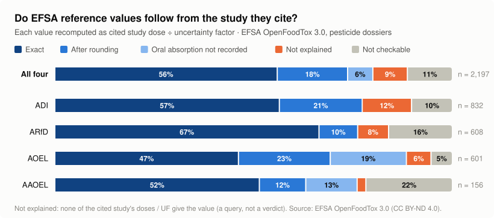
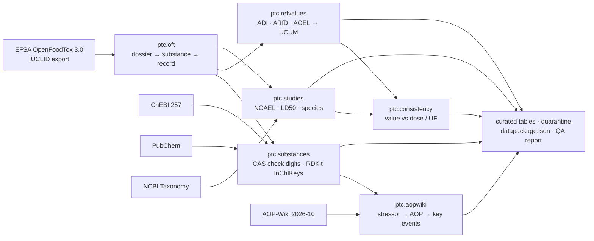

<div align="center">

# pesticide-tox-curation

**EFSA's pesticide toxicology, curated into FAIR, ontology-mapped tables, with a check that
every safety threshold follows from the study it cites.**

[](https://github.com/gbadedata/pesticide-tox-curation/actions/workflows/ci.yml)


[](LICENSE)

[Findings](#findings) · [How it works](#how-it-works) · [Outputs](#outputs) · [FAIR](#fair-in-practice) · [Run it](#run-it) · [Decisions](docs/decisions.md) · [QA report](reports/qa_report.md)

</div>

<p align="center">
  <picture>
    <source media="(prefers-color-scheme: dark)" srcset="reports/figures/refvalue_consistency_dark.svg">
    
  </picture>
</p>

## Why this exists

Acceptable daily intakes, acute reference doses and operator exposure levels are the
numbers that product-safety and regulatory work is built on. EFSA publishes them, with
the studies they come from, in [OpenFoodTox](https://doi.org/10.5281/zenodo.19388272),
an IUCLID-structured export. To be usable for AI and ML, that data needs three things it
doesn't have out of the box: chemical identities that resolve, units that compare, and
links to ontologies and mechanistic knowledge. It also needs evidence that each value
really follows from its evidence.

This project does that for every substance in EFSA's pesticide dossiers, and reports
every place where the data doesn't hold together. Every input is a real public source;
nothing is synthetic, including the test fixtures.

| | |
|---|---|
| Pesticide dossiers | **2,043** |
| Substances | **1,513** (410 active substances, 1,073 residues and metabolites) |
| Reference values harmonised | **2,613** (ADI, ARfD, AOEL, AAOEL and 23 other descriptors) |
| Study effect levels harmonised | **5,248** (NOAEL, LOAEL, BMDL, LD50, ...) from 3,010 study records |
| EFSA outputs traced (DOIs) | **670** |

## Findings

### 1. Most reference values follow from their cited study, and the exceptions are specific

Each ADI, ARfD, AOEL and AAOEL in OpenFoodTox names a pivotal study record and an overall
uncertainty factor (UF). So each value can be recomputed as *study dose / UF*, multiplied by
oral absorption for AOELs when it is recorded.

| Outcome | Values |
|---|---:|
| Follows exactly | 1,241 |
| Follows after rounding (to nearest at 1-2 significant figures, or up/down at 2) | 388 |
| **Follows: 1,629 of 1,951 checkable (83.5%)** | |
| AOEL below dose / UF, with no oral absorption recorded | 135 |
| Not explained by the cited study | 187 |
| ...off by exactly 10x | 14 |
| ...equal to the study dose itself (as if no UF were applied) | 1 |
| Not checkable (no cited study, no UF, or no usable dose in the cited study) | 246 |

Three of the off-by-ten cases:

| Substance | Value as recorded | Cited study dose / UF | EFSA output |
|---|---|---|---|
| Oxyfluorfen | ADI 0.003 mg/kg bw/day | NOAEL 3 / 100 = 0.03 | [10.2903/j.efsa.2010.1906](https://doi.org/10.2903/j.efsa.2010.1906) |
| Spiromesifen | ARfD 2 mg/kg bw | NOAEL 2,000 / 100 = 20 | [10.2903/j.efsa.2012.2879](https://doi.org/10.2903/j.efsa.2012.2879) |
| Tralkoxydim | ARfD 0.1 mg/kg bw | NOAEL 1 / 100 = 0.01 | [10.2903/j.efsa.2008.139r](https://doi.org/10.2903/j.efsa.2008.139r) |

> [!NOTE]
> These are leads, not verdicts. A mismatch can come from the export (a NOAEL or UF
> recorded wrongly) rather than from EFSA's published assessment, and none has yet been
> checked against the published conclusions. Each one comes with its record UUID and DOI,
> so a curator can resolve it in minutes.

### 2. Chemical identity

- **Structures:** InChIKeys were computed with RDKit from OpenFoodTox's own InChI and
  SMILES. For **13 substances the two describe different molecules.** For 3,5,6-TCP the
  InChI is trichloropyridinol (C5H2Cl3NO), but the SMILES is a dichloro, methyl-substituted
  compound (C6H5Cl2NO). For a pyrazole metabolite named *...trifluoromethylsulfonyl...*,
  the InChI matches the name, while the SMILES and the formula field both encode a sulfinyl
  group. A further 94 agree on the skeleton but differ in stereochemistry or charge, and 12
  SMILES don't parse.
- **CAS numbers:** 3-acetamidophenol is recorded as 621-41-2, which fails the CAS check
  digit. Triflumizole carries two different CAS numbers.
- **PubChem** (CAS number -> PubChem structure, compared with the curated InChIKey): 613
  substances agree and 60 differ only in stereochemistry. The 24 disagreements are sorted
  rather than counted as errors:

  | Group | Substances |
  |---|---:|
  | Same molecule once salts or mixture components are stripped | 9 |
  | Metals or inorganics that PubChem and InChI write differently | 8 |
  | Same formula, different connectivity (pyridalyl, spirodiclofen, tralkoxydim) | 3 |
  | Different formula (e.g. the CAS for 2-methylpropyl methanesulfonate resolves to a C11 terpene alcohol) | 4 |

  The 23 CAS numbers PubChem doesn't know are mostly oils, extracts and mixtures with no
  single structure.
- **ChEBI:** 587 substances map to ChEBI, including 367 of the 410 active substances. Of
  those, **112 have no agrochemical role asserted in ChEBI**, a gap in the ontology rather
  than in EFSA's data.

### 3. Units and recording

- **2,430** effect levels where IUCLID's unit picklist was bypassed: `other:` was chosen,
  then `mg/kg bw/day` typed by hand.
- **462** single-dose LD50s recorded "per day"; **13** ADI/AOEL values missing "/day".
- **159** reference values stored in the upper-bound field with no qualifier.
- One unit with encoding damage (`µg` for `µg`): UTF-8 read as Latin-1 somewhere upstream.
- 23 study records give the species only as "mammal" or similar, so they stay unmapped
  rather than guessed.

### 4. Links to mechanisms

**43 substances link to 49 Adverse Outcome Pathways** in AOP-Wiki, 8 of them
OECD-endorsed, for example fenpyroximate and tebufenpyrad to AOP 3 (*complex I inhibition
leading to parkinsonian motor deficits*). Each link carries the AOP's molecular initiating event,
adverse outcome and key-event ontology terms (GO, UBERON, CL, HP, MP).

## How it works



- **IUCLID linkage.** Dossiers link to substances through `DOSSIER_DOCS`, substances to
  their reference substances (identifiers) and records through document UUIDs, and each
  reference value to its pivotal study through `CriticalEndpoint`. The substance and
  record links were checked to resolve 100% on the 2026 export before anything was built
  on them.
- **Nothing is silently dropped.** Each row carries reason codes in `issues`. Rows that
  can't be used as numbers go to `quarantine` with those codes.
- **Every interpretation is a documented decision** ([`docs/decisions.md`](docs/decisions.md)),
  flagged on the rows it touches and reversible by filtering on its code. Examples: reading
  an LD50 "per day" as a single dose, and taking ChEBI roles only from the substance itself,
  because inheriting them from structural parents labels glyphosate a fungicide.

## Outputs

`python -m ptc.pipeline` writes these to `data/curated/` as Parquet and CSV, described
field by field in [`schema/datapackage.json`](schema/datapackage.json):

| Table | Rows | One row per | Standards |
|---|---:|---|---|
| `substances` | 1,513 | pesticide-domain substance | CAS, InChIKey, ChEBI, PubChem CID, EFSA role |
| `reference_values` | 2,613 | reference value per summary document | UCUM, canonical mg/kg bw(/day), EFSA DOI |
| `effect_levels` | 5,248 | effect level per study record | UCUM, NCBI Taxonomy, EFSA DOI |
| `refvalue_consistency` | 2,197 | ADI / ARfD / AOEL / AAOEL value | status + error pattern |
| `aop_links` | 104 | substance-to-AOP link | AOP-Wiki IDs, GO / UBERON / CL terms |
| `quarantine` | 16 | unusable row | reason codes |

## FAIR in practice

| Principle | How |
|---|---|
| **Findable** | Every field described in a Frictionless Data Package; every row keyed by persistent identifiers (IUCLID UUID, EFSA DOI, InChIKey, ChEBI, NCBITaxon) |
| **Accessible** | One command fetches every source from its public home, with MD5 and SHA-256 checksums |
| **Interoperable** | Units as UCUM codes, chemicals as InChIKey and ChEBI CURIEs, species as NCBITaxon CURIEs, mechanisms as AOP-Wiki IDs with GO and UBERON terms |
| **Reusable** | Provenance and licence per source in `manifest.json`; reason-coded issues; every curation decision written down |

**Licensing.** OpenFoodTox is released under CC BY-ND 4.0, which doesn't allow sharing
modified versions. So this repository publishes the code, the schema and aggregate
results, and the curated tables are rebuilt locally from the original source. Test
fixtures are small unmodified extracts with attribution
([`tests/fixtures/README.md`](tests/fixtures/README.md)).

## Run it

```bash
pip install -e ".[dev]"
python3 scripts/fetch_sources.py --skip-pubchem     # OpenFoodTox, AOP-Wiki, ChEBI, NCBI Taxonomy (~5 min)
python3 -m ptc.pipeline                             # curated tables + report (~1 min)
python3 scripts/fetch_sources.py --pubchem-only --cas-list data/interim/pesticide_cas.txt   # ~10 min
python3 -m ptc.pipeline                             # re-run with the PubChem cross-check
```

Or `make fetch build pubchem build`. The PubChem step stays under PubChem's request
limit and resumes from its cache if interrupted.

```
src/ptc/           oft · substances · refvalues · studies · consistency · aopwiki · package · report · figures
scripts/           fetch_sources.py (all downloads + provenance) · make_fixtures.py
schema/            datapackage.json (field-level metadata)
reports/           qa_report.md · figures/
docs/              decisions.md
tests/             29 tests on unmodified slices of the real sources
```

## Testing

`pytest` runs 29 tests. The OpenFoodTox fixtures are seven real reference-value documents,
each chosen because it shows one behaviour: exact, rounded, absorption, off by ten, value
in the upper field, missing "/day" and encoding damage. Alongside them are the study
records those documents cite, a ChEBI slice, an NCBI Taxonomy slice and the AOP-Wiki entry
for AOP 3. CI runs lint and tests on Python 3.10, 3.11 and 3.12. The full pipeline
produces a byte-identical report on pandas 2.3 and pandas 3.0.

## Limitations and next steps

- **Scope** follows EFSA's dossier food domain. A substance assessed only in other domains
  is out of scope.
- **Effect levels** cover human-health study records. Aquatic and terrestrial
  ecotoxicology records are the next table.
- **The consistency check** uses only the study EFSA cites. A value derived from another
  study, or from a UF the export records only in parts, shows as "not explained".
- **ChEBI roles** are used as asserted; missing roles are reported, not inferred.
- **Next:** LLM-assisted extraction of reference values from EFSA conclusion documents,
  scored against these curated values with a human-checked sample; links to EPA CompTox
  (DTXSID) and ToxCast.

## Sources

| Source | Version | Licence |
|---|---|---|
| [EFSA OpenFoodTox](https://doi.org/10.5281/zenodo.19388272) | 3.0 export, April 2026 | CC BY-ND 4.0 |
| [AOP-Wiki](https://aopwiki.org/downloads) | quarterly XML, 2026-10-01 | per-AOP licences |
| [ChEBI](https://www.ebi.ac.uk/chebi/) | release 257 | CC BY 4.0 |
| [NCBI Taxonomy](https://www.ncbi.nlm.nih.gov/taxonomy) | names.dmp, November 2026 | public domain |
| [PubChem](https://pubchem.ncbi.nlm.nih.gov/) | PUG-REST, November 2026 | public domain |

---

Built by [Oluwagbade Odimayo](https://gbadedata.com) · plant geneticist turned data scientist.
